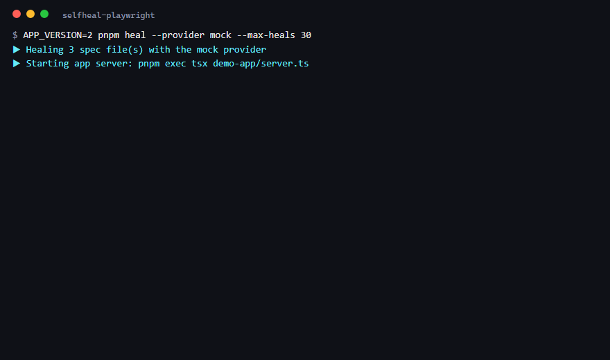
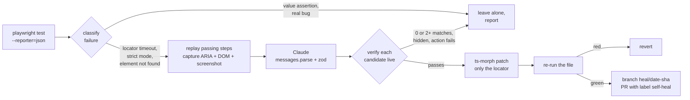
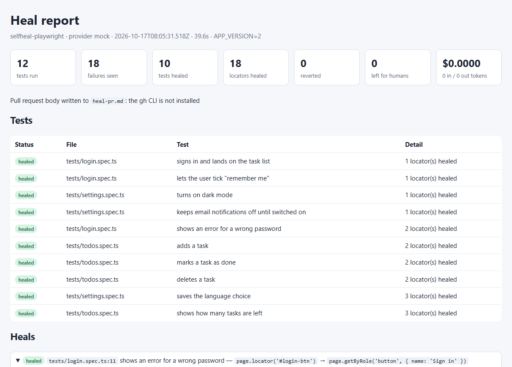

# selfheal-playwright

[](https://github.com/jumilandelapena/selfheal-playwright/actions/workflows/ci.yml)


**A self-healing end-to-end test agent.** When a Playwright test fails because a
locator no longer matches, the agent opens the same page in headless Chromium,
replays the steps that still pass, shows the accessibility tree, the DOM and a
screenshot to Claude, asks for up to three replacement locators as validated
JSON, proves each candidate on the live page (exactly one element, visible, the
original action succeeds), patches only that locator with ts-morph, re-runs the
test, and opens a pull request for a human to review. Real bugs are left alone:
assertion failures on values are never "healed", and nothing is ever merged
automatically.



*Real console output of `APP_VERSION=2 pnpm heal --provider mock` (rendered from
[`docs/demo-run.log`](docs/demo-run.log)).*

## Pipeline



## How it works

1. **Run and classify.** `playwright test --reporter=json` runs the allow-listed
   spec files. Each failure is classified from its message: locator timeouts,
   strict-mode violations and `element(s) not found` are healable; anything
   with a received value (`toHaveText` mismatch, `toBeVisible` on a hidden
   element, `expect(x).toBe(y)`) is a real failure and is only reported.
2. **Reproduce.** The test body is parsed with ts-morph into steps
   (`page.goto`, locator actions, `expect`, `test.step`, `beforeEach`). The
   steps before the failing line are replayed in a fresh browser context.
3. **Capture.** The agent takes `page.locator('body').ariaSnapshot()`, a
   trimmed DOM (no scripts, styles or svg, max 30k chars) and a screenshot.
4. **Ask.** `client.messages.parse` with a zod output format asks
   `claude-opus-5-5` for at most three candidates
   `{ locator, kind, confidence, reason }`, preferring `getByRole` and
   `getByTestId` over text and CSS, never positional or generated selectors.
   `stop_reason` is checked first; `refusal` and `max_tokens` mean "no idea".
5. **Verify, then patch.** Candidates are parsed into an AST (never `eval`-ed)
   and tried on a freshly replayed page, best confidence first. The first one
   that resolves to exactly one visible element and survives the original
   action or assertion replaces the old locator. ts-morph edits that single
   call expression; the patcher proves every other byte is unchanged.
6. **Prove it and hand it over.** The patched file is re-run. Green: the heal
   is recorded. Red: the patch is reverted. Then one branch
   `heal/<yyyy-mm-dd>-<sha>`, one commit, one pull request titled
   `fix(tests): self-heal N locators` with a table, the before screenshots and
   the full report, labelled `self-heal`. Without `gh` or a token the body
   lands in `heal-pr.md`.

## Quick start

```bash
pnpm install && pnpm exec playwright install chromium   # 1. dependencies and a browser
pnpm test                                               # 2. 12 tests, green against APP_VERSION=1
APP_VERSION=2 pnpm test                                 # 3. 10 of them break on the renamed markup
APP_VERSION=2 pnpm heal --provider mock --dry-run       # 4. heal them without an API key, see the diff
APP_VERSION=2 pnpm heal --max-heals 20                  # 5. the real thing: needs ANTHROPIC_API_KEY (+ GITHUB_TOKEN for the PR)
```

On Windows PowerShell set the variable first: `$env:APP_VERSION = '2'`. Copy
`.env.example` to `.env` to keep the keys out of your shell history.

## Example pull request

- [`docs/example/pr-body.md`](docs/example/pr-body.md) is the exact body the
  agent wrote during the run shown above (18 locators, 10 tests, 4 rounds).
- [`docs/example/heal-report.html`](docs/example/heal-report.html) and
  [`heal-report.json`](docs/example/heal-report.json) are the matching reports;
  [`docs/example-heal-report.md`](docs/example-heal-report.md) walks through
  them.
- A live PR: run the manual `heal-live` workflow (Actions → CI → Run workflow)
  with `ANTHROPIC_API_KEY` in the repository secrets. It heals with Claude and
  opens the PR against `main`. _Link to the first live PR: `https://github.com/jumilandelapena/selfheal-playwright/pulls?q=label%3Aself-heal`._



## The demo app

`demo-app/` is a tiny task manager (login form, task list, settings page)
served by a dependency-free Node server. `APP_VERSION=2` renames ids, classes,
test ids and button text (`#login-btn` becomes `data-testid="signin"`, "Add
task" becomes "New task", the settings "back" link gains the `btn` class so
`.btn` turns into a strict-mode violation). Labels, roles and behaviour do not
change, which is exactly why the healed locators can be accessibility-based.

`tests/` holds 12 Playwright tests written against v1 with a deliberate mix of
CSS, `getByRole`, `getByText`, `getByLabel` and `getByTestId`. Ten break on v2.

## CLI

```
pnpm heal [options]
  --provider <anthropic|mock>  AI provider (default anthropic; mock needs no API key)
  --dry-run                    patch, verify, print the diff, then restore the files; no commit, no PR
  --max-heals <n>              maximum locator patches per run (default 5)
  --min-confidence <0-1>       ignore candidates below this confidence (default 0.7)
  --files <glob>               allowlist of spec files, repeatable or comma-separated
  --max-rounds <n>             maximum run → heal rounds (default 5)
  --out <dir>                  reports and screenshots (default heal-output)
  --base-url <url>             app URL (default use.baseURL from playwright.config.ts)
  --effort <low|medium|high>   reasoning effort for Claude (default low)
  --mock-answers <file>        JSON answers for the mock provider
  --no-pr                      patch the files but do not open a pull request
  --verbose                    debug output
```

Every run writes `heal-output/heal-report.json`, a self-contained
`heal-output/heal-report.html` and one "before" screenshot per heal.

## Will it work on my suite?

Run the compatibility report first. It parses every test of another project
with the healer's own step parser and tells you how much it could replay,
without executing anything:

```bash
pnpm compat ../my-project 'tests/**/*.spec.ts'
```

The healer replays steps written directly in the test body (`page.goto`,
`page.<locator>.<action>()`, `expect(page.<locator>)`, `test.step`,
`beforeEach`). Suites built on page objects or custom fixtures score close to
0% today; on those the healer still runs, classifies and reports every
failure, but refuses to patch with the reason "cannot replay" or "the failure
happened inside <page object>:<line>". See the roadmap below.

For slow-rendering apps raise `--action-timeout` (for example `15000`) so a
correct candidate is not rejected while a spinner is still up.

## CI

[`.github/workflows/ci.yml`](.github/workflows/ci.yml) has three jobs:

| Job | Trigger | What it proves |
|---|---|---|
| `test` | every push / PR | type-check, the agent's own vitest suite, and the Playwright suite green on `APP_VERSION=1` |
| `heal-demo` | every push / PR | `APP_VERSION=2` + `pnpm heal --provider mock --dry-run`, asserts at least 6 healed tests, runs the sandboxed end-to-end test, uploads the report as an artifact. No API key, no cost. |
| `heal-live` | manual `workflow_dispatch` | the same with `claude-opus-5-5` and `GITHUB_TOKEN`; opens the pull request |

## Design decisions

**Verify before patching.** A locator that looks right in the DOM dump can
still match two elements, a hidden one, or the label instead of the input. So
every candidate is executed on a freshly replayed page with the test's own
action and arguments (`fill('Buy milk')`, `toHaveText('2 tasks left')`), and the
patched file must pass end to end before the heal counts. Rejected candidates
stay in the report so the reviewer sees what the model proposed and why it was
refused.

**Pull request, not auto-merge.** The agent knows the page, not the product. A
renamed button and a removed button look the same to it. A PR with the old and
new locator side by side, the model's reason, the confidence and the screenshot
is a two-minute review; a silent merge is a liability. The branch is always
fresh (`heal/<date>-<sha>`), never `main`, and the label `self-heal` makes the
history searchable.

**Mock provider in CI.** The pipeline runs on every push with fixed answers, so
CI proves the classifier, replay, verifier, patcher and round loop without an
API key or spend. Two mock answers are deliberately bad (one matches two
elements, one is below the confidence threshold) so the safety paths run on
every commit too. The live job is manual and needs a secret.

**Rounds instead of one shot.** A test stops at its first failure, so a file
with three renamed locators needs three run → heal cycles. A test is only
reported as healed after a green run, and a test that cannot be fully fixed has
all of its patches reverted; half-repaired tests never reach the PR.

**No `eval`.** Model output is parsed with the TypeScript compiler into a chain
of allow-listed Playwright calls with literal arguments. `page.evaluate(...)`,
identifiers or template strings are rejected before anything touches a
browser.

**Cost per heal.** With `claude-opus-5-5` ($4 / $20 per million input / output
tokens) one heal sends about 6–10k tokens (DOM + ARIA + screenshot) and gets a
few hundred back at `low` effort: roughly **$0.03–0.06 per heal**, about $0.50
to $1 for the whole demo suite. The report shows measured tokens and the
estimate, and identical failures on the same page share one call.

## The agent's own tests

`pnpm test:agent` (vitest, [`tests-agent/unit`](tests-agent/unit)):

- **classifier** — real Playwright messages: locator timeout vs strict mode vs
  element-not-found vs value assertions, `toHaveCount` 0, found-but-disabled,
  navigation timeouts, ANSI colours.
- **patcher** — replaces exactly one locator, leaves every other byte
  identical (including a second occurrence on another line and CRLF files),
  reverts, refuses unknown lines.
- **verifier** — real Chromium: rejects 0 and 2+ matches, hidden elements,
  failing actions and wrong expected values; honours `toHaveCount`.
- **locator expressions** — allow-listed parsing, forbidden positional/hashed
  selectors, chain rebuilding.
- **steps** — hooks, `test.step`, `.not`, `expect(page)`, unsupported
  statements, duplicate titles.
- **providers** — mock answers; Anthropic request shape (model id, zod format,
  screenshot block) and `refusal` / `max_tokens` / unparseable handling with a
  fake client.
- **report and PR** — Markdown/HTML rendering, cost estimate, `heal-pr.md`
  fallback without touching branches.

`pnpm test:e2e-mock` ([`tests-agent/e2e`](tests-agent/e2e)) copies the project
into a temp sandbox, serves `APP_VERSION=2`, runs the CLI with the mock
provider and asserts 18 healed locators, patched files, the PR-body fallback
and a green Playwright run afterwards.

## Limitations and roadmap

- **Only the test body is replayed.** Failures inside helpers or page objects
  are reported as "cannot replay" instead of guessed. Next: resolve helper
  calls through the TypeScript program.
- **Conservative classifier.** `toHaveCount` receiving 0 is treated as a value
  failure, because a renamed list and an empty list look alike.
- **Chromium only.** Multi-browser verification (WebKit, Firefox) is a config
  change away but not wired yet.
- **No visual diff.** A screenshot before/after comparison would catch heals
  that resolve to the right role but the wrong widget.
- **No ticket integration.** A Jira/Linear hook that files the unhealed tests
  with their screenshots is on the list.
- **Frames and shadow DOM** are untested.

## Project layout

```
demo-app/        login, tasks and settings pages; APP_VERSION=1|2 markup variants
tests/           12 Playwright tests written against v1
src/healer/      the agent: runner → classifier → steps → capture → providers → verifier → patcher → pr
src/cli/         pnpm heal
tests-agent/     vitest: unit + sandboxed end-to-end
scripts/         CI assertion, README media generator
docs/            architecture, example report and PR body, demo GIF
.github/         CI with test, heal-demo and heal-live jobs
```

## License

MIT
