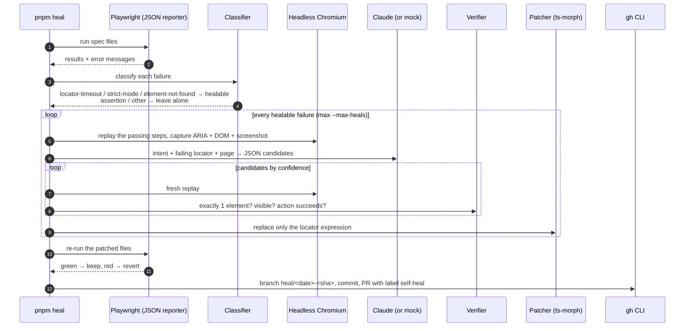

# Architecture

selfheal-playwright is a small agent with one job: when a Playwright test fails
because a locator no longer matches, find the element the test meant, prove the
new locator works, patch the test, and hand the change to a human.

## Pipeline



## Rounds

One run of the suite rarely shows every broken locator: a test stops at its
first failure. The orchestrator therefore works in rounds.

```
round 1  run all files ──► failures ──► heal each ──► patched files
round 2  run patched files only
           test passed            → heal confirmed
           fails further down     → still pending, heal the new line
           fails at the same line → revert every patch of that test
           fails with a value assertion → revert, this is a real bug
round N  until nothing healable is left, --max-rounds, or --max-heals
```

A test is only reported as healed after a green run. Partial progress is never
kept: if the third locator of a test cannot be fixed, the first two patches are
reverted too, so the pull request never contains a half-repaired test.

## Modules

| File | Responsibility |
|---|---|
| `src/healer/runner.ts` | Runs `playwright test --reporter=json` without a shell and turns the report into `TestFailure`s with file, line and column. |
| `src/healer/classifier.ts` | Decides whether a failure is a broken locator. Conservative by design: timeouts whose call log shows the element *was* found, `toHaveCount` receiving 0, and any `Received:` value are left alone. |
| `src/healer/steps.ts` | Parses the test body with ts-morph into replayable steps (`page.goto`, locator actions, `expect`, `test.step`, `beforeEach` hooks). Anything else is marked unsupported and the test is skipped rather than guessed. |
| `src/healer/locator-expression.ts` | Parses locator expressions into an AST and rebuilds them by calling Playwright methods. No `eval`: a candidate can only ever be a chain of allow-listed methods on `page` with literal arguments. Also rejects brittle styles (`nth-child`, `first()`, XPath, hashed class names). |
| `src/healer/replay.ts` | Launches Chromium, replays steps, and runs single actions/assertions with the same `expect` the test runner uses. |
| `src/healer/capture.ts` | ARIA snapshot (`page.locator('body').ariaSnapshot()`), trimmed DOM (scripts, styles and svg removed, max 30k chars), screenshot. |
| `src/healer/providers/anthropic.ts` | `client.messages.parse` with a zod output format and `claude-opus-5-5`. Checks `stop_reason` before trusting `parsed_output`; `refusal` and `max_tokens` mean "no suggestion". |
| `src/healer/providers/mock.ts` | Fixed answers keyed by the failing locator so CI and tests need no API key. Some answers are deliberately bad to exercise the verifier. |
| `src/healer/verifier.ts` | A candidate passes only if it resolves to exactly one element (or the asserted count), the element is visible, and the original action or assertion succeeds on it. |
| `src/healer/patcher.ts` | Replaces one call-expression node with ts-morph, then checks that the file equals `before.slice(0, start) + newLocator + before.slice(end)` before writing. Assertions, expected values and formatting cannot change. |
| `src/healer/heal.ts` | The round loop, pending/revert bookkeeping, suggestion cache, reports. |
| `src/healer/pr.ts` | Branch `heal/<yyyy-mm-dd>-<sha>`, commit, push, `gh pr create` with label `self-heal`. Falls back to `heal-pr.md` when `gh` or a token is missing. Refuses to use `main`/`master`. |
| `src/healer/report.ts` | `heal-report.json`, a self-contained `heal-report.html` (screenshots inlined) and the Markdown PR body. |
| `src/cli/heal.ts` | Argument parsing with `node:util.parseArgs`, `.env` loading, demo-app sanity warning. |

## What the model sees

For each failure the provider receives one user message:

- test title, `test.step` title (the intent), file and line, the failing statement
- the failing locator, the action (`click`, `fill`, `expect.toHaveText`, …) and its arguments
- the classification and the first lines of the error
- page URL and title
- the ARIA snapshot as YAML
- the trimmed DOM of `<body>`
- the screenshot as a base64 PNG block

It must answer with this JSON, enforced server-side through structured outputs:

```ts
{ candidates: [{ locator: string, kind: 'role' | 'testid' | 'text' | 'label' | 'css', confidence: number, reason: string }] }
```

The system prompt fixes the locator preference order (`getByRole`, `getByTestId`,
`getByLabel`/`getByPlaceholder`, `getByText`, CSS last), forbids positional and
generated selectors, and asks for an empty list when nothing matches the intent.

## Safety model

| Risk | Mitigation |
|---|---|
| Healing a real bug | The classifier only accepts locator timeouts, strict-mode violations and "element(s) not found". Everything with a received value is a value failure and is reported, not touched. |
| Replacing a locator with the wrong element | Every candidate is verified on a freshly replayed page: one match, visible, original action and assertion succeed with the original arguments. The patched test must then pass end to end. |
| Executing model output | Candidates are parsed into an AST and rebuilt from allow-listed Playwright calls. Nothing is `eval`-ed. |
| Silent edits elsewhere in the file | The patcher proves the write is a single-range substitution before saving. |
| Runaway runs | `--max-heals` (default 5), `--max-rounds` (default 5), `--min-confidence` (default 0.7), `--files` allowlist, `--dry-run`. |
| Unreviewed changes | Always a new branch, always a pull request, never a merge, never `main`. |
| Secrets | Keys come from the environment only; `.env` is git-ignored and `.env.example` documents it. |

## Cost

With `claude-opus-5-5` at $4 per million input tokens and $20 per million output
tokens, one heal sends roughly 6–10k input tokens (DOM + ARIA + screenshot) and
receives a few hundred output tokens at `low` effort, so a heal costs about
**$0.03–0.06**. The report prints the measured usage and the estimate. Identical
failures on the same page within a run share one model call.

## Extending

- **Another model or provider**: implement `HealProvider` (`suggest(request)`),
  register it in `src/healer/providers/index.ts`.
- **More actions or matchers**: add them to `ACTION_VALUE_ARGS` in
  `src/healer/replay.ts`; matchers only need a value-argument count when it is
  not the default (`toBe*` take none, `toHave*` take one).
- **Page objects and helpers**: steps are parsed from the test body only. A
  failure inside a helper is reported as "cannot replay" today; resolving
  helper calls through the TypeScript program is the next step on the roadmap.
